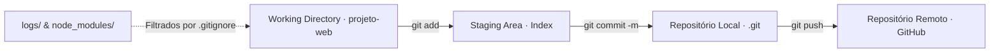

<p align="center">
  
</p>

<p align="center">Pesquisa e laboratório prático sobre commits, branches e fluxo local de versionamento.</p>


<p align="center"><a href="#visão-geral">Visão geral</a> &nbsp;·&nbsp; <a href="#recursos">Recursos</a> &nbsp;·&nbsp; <a href="#como-explorar">Como explorar</a></p>

<p align="center"></p>

<a id="explore-o-projeto"></a>

## Por onde começar


- **[Pesquisa](Pesquisa-Git-Fluxo-Local.pdf)** — Material de referência em PDF.
- **[Comandos](projeto-web/comandos.txt)** — Folha de consulta dos comandos Git.
- **[Exemplo](projeto-web/index.html)** — Página usada no laboratório de versionamento.


<a id="visão-geral"></a>

## Visão geral

O diretório projeto-web/ simula a estrutura real de uma aplicação front-end — incluindo código-fonte (index.html, style.css, app.js), arquivos de log (logs/app.log), dependências simuladas (node_modules/) e uma folha de referência rápida de comandos (comandos.txt).

<a id="recursos"></a>

## Recursos

**Documento Técnico em PDF**<br>
Pesquisa-Git-Fluxo-Local.pdf detalha os estados dos arquivos (untracked, modified, staged, committed) e a anatomia do fluxo local.

**Laboratório Prático (projeto-web)**<br>
Projeto web funcional projetado para testar git status, git add, git diff, git commit e git log.

**Cenário de .gitignore**<br>
Inclui diretórios logs/ e node_modules/ para demonstrar como ignorar artefatos temporários e pacotes de terceiros.

**Guia de Comandos (comandos.txt)**<br>
Roteiro passo a passo de comandos de terminal usados durante a apresentação prática.

<details>
<summary>Arquitetura do fluxo Git estudado</summary>



</details>

<details>
<summary>Estrutura do repositório</summary>

```text
Pesquisa-versionamento-Git/
├── assets/
│   └── identity/banner.png               Banner do projeto
├── projeto-web/
│   ├── assets/                         style.css e app.js da aplicação demonstrativa
│   ├── logs/app.log                    Exemplo de arquivo de log para teste de .gitignore
│   ├── node_modules/                   Exemplo de diretório de dependências
│   ├── comandos.txt                    Referência rápida de comandos Git no terminal
│   ├── index.html                      Página principal do projeto demonstrativo
│   └── README.md                       Instruções específicas do laboratório
├── Pesquisa-Git-Fluxo-Local.pdf        Artigo e apresentação sobre fluxo local no Git
└── README.md
```

</details>

<a id="como-explorar"></a>

## Como explorar

1. Clone o repositório:
   ```bash
   git clone https://github.com/arthurlynow098/Pesquisa-versionamento-Git.git
   ```
2. Abra o documento [Pesquisa-Git-Fluxo-Local.pdf](Pesquisa-Git-Fluxo-Local.pdf) para acompanhar a fundamentação teórica.
3. Acesse a pasta projeto-web/, consulte comandos.txt e abra projeto-web/index.html no navegador.

<p align="center"></p>

<p align="center">
  <a href="https://github.com/arthurlynow098">GitHub</a> &nbsp;·&nbsp;
  <a href="https://arthurentsev.vercel.app/">Portfólio</a> &nbsp;·&nbsp;
  <a href="https://www.linkedin.com/in/entsevarthur/">LinkedIn</a>
</p>
